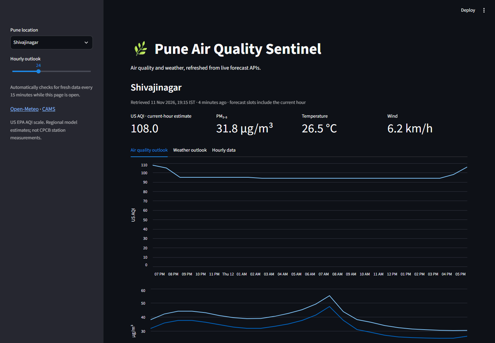

# Pune Air Watch

A Python-based air quality monitoring and forecasting platform for Pune, India, combining environmental data, interactive visualisations, and experimental machine learning models.

## Overview

Pune Air Watch helps explore air quality across different locations in Pune through two main components:

- **Air Quality Monitoring:** Displays air quality and weather forecasts using data from Open-Meteo and Copernicus CAMS.
- **Air Quality Forecasting:** Explores historical pollution patterns using machine learning models such as ARIMA, LSTM, and Spatio-Temporal Graph Neural Networks (ST-GNN).

The project provides an interactive Streamlit dashboard and a FastAPI backend.

## Screenshots

### Dashboard Overview


### Air Quality Heatmap


### Forecasting Interface


### Model Comparison


### Live API


## Features

- Air quality and weather forecasts for 10 predefined Pune locations.
- Hourly environmental data, including AQI, PM2.5, PM10, temperature, and humidity.
- Interactive dashboard with visualisations and heatmaps.
- REST API for accessing monitoring and forecasting services.
- Historical air quality and weather data processing.
- Synthetic IoT sensor data generation.
- Experimental machine learning models for air quality forecasting.
- Model evaluation and comparison.

## Technology Stack

| Category | Technologies |
|---|---|
| Programming Language | Python |
| Dashboard | Streamlit |
| Backend | FastAPI |
| Data Processing | Pandas, NumPy |
| Machine Learning | PyTorch, Scikit-learn |
| Forecasting | ARIMA, LSTM, ST-GNN |
| Visualisation | Matplotlib, Folium |

## Data Sources

- [Open-Meteo](https://open-meteo.com/) – Air quality and weather data.
- [Copernicus CAMS](https://atmosphere.copernicus.eu/) – Atmospheric composition data accessed through Open-Meteo.
- [OpenAQ](https://openaq.org/) – Historical air quality observations.
- [Kaggle](https://www.kaggle.com/) – Historical air quality datasets.

## Getting Started

### Requirements

- Python 3.11
- Git
- Internet connection for external environmental data.

### 1. Clone the repository

```bash
git clone https://github.com/xt67/Pune-AQI-Monitor.git
cd Pune-AQI-Monitor
```

### 2. Create a virtual environment

```bash
python -m venv .venv
```

Activate it:

**Windows:**
```powershell
.venv\Scripts\Activate.ps1
```

**Linux / macOS:**
```bash
source .venv/bin/activate
```

### 3. Install dependencies

For the dashboard and API:

```bash
pip install -r requirements.txt
```

For additional machine learning and research dependencies:

```bash
pip install -r requirements-dev.txt
```

### 4. Run the dashboard

```bash
streamlit run app/streamlit_app.py
```

Open `http://localhost:8501` in your browser.

### 5. Run the API

In a separate terminal:

```bash
uvicorn app.api.main:app --reload
```

API documentation is available at:

`http://127.0.0.1:8000/docs`

## Machine Learning

The project includes experimental air quality forecasting approaches:

- **ARIMA:** Statistical time-series forecasting.
- **LSTM:** Deep learning for temporal pattern recognition.
- **ST-GNN:** Graph-based modelling of spatial and temporal relationships.

The repository includes model training, preprocessing, evaluation, and inference utilities. Historical datasets and trained checkpoints are not included in the default checkout.

## Project Structure

```text
Pune-AQI-Monitor/
│
├── app/
│   ├── api/                 # FastAPI backend
│   └── streamlit_app.py     # Streamlit dashboard
│
├── configs/                 # Configuration files
├── data/                    # Data and graph metadata
├── docs/
│   ├── screenshots/         # Project screenshots
│   └── results/             # Model evaluation results
│
├── src/
│   ├── data/                # Data collection and preprocessing
│   ├── models/              # Forecasting models
│   ├── evaluate/             # Model evaluation
│   └── viz/                 # Visualisation utilities
│
├── tests/                   # Automated tests
├── requirements.txt
├── requirements-dev.txt
└── README.md
```

## Important Notes

- Live air quality values are external forecast estimates, not measurements from locally deployed sensors.
- The live application uses the US EPA AQI standard, not the Indian CPCB AQI standard.
- CAMS global forecast data has approximately 45 km spatial resolution. Nearby locations may therefore share similar readings.
- Live monitoring is independent of the experimental machine learning models.
- This project is intended for educational and research purposes, not as a certified environmental monitoring or health advisory service.

## License

This project is licensed under the MIT License. See [LICENSE](LICENSE) for details.

## Author

**Rayan Rahman**

GitHub: [@xt67](https://github.com/xt67)
